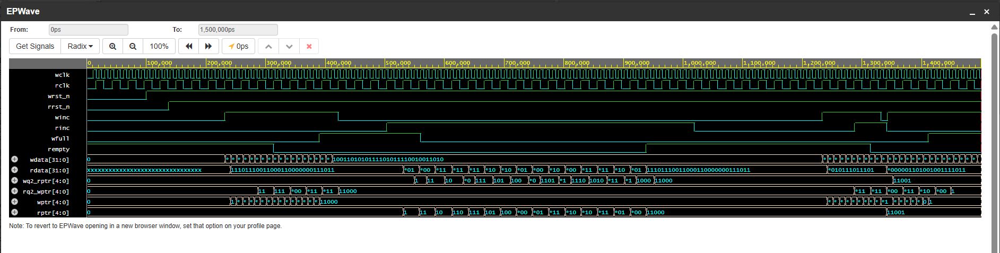
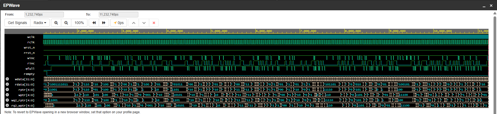

# Asynchronous FIFO — SystemVerilog

A parameterized asynchronous FIFO with independent read and write clock domains, Gray-coded pointers, clock-domain-crossing (CDC) synchronizers, and a self-checking SystemVerilog testbench.

## Project Overview

This project implements a **16-entry × 32-bit asynchronous FIFO** for transferring data between two independently clocked domains.

The design uses binary pointers for memory addressing and Gray-coded pointers for synchronizing read and write positions across clock domains.

## Key Features

- 16-word FIFO depth with 32-bit data width
- Independent read and write clocks
- Binary and Gray-coded read/write pointers
- Two-flop synchronizers for cross-domain pointer synchronization
- Full and empty flag generation
- Self-checking testbench with a scoreboard
- Randomized clock phase and jitter testing
- Overflow and underflow protection checks
- Mid-run reset testing
- Gray-code transition monitoring

## Architecture

The design is organized into six SystemVerilog modules:

- `fifo_mem` — FIFO storage and data read/write logic
- `sync_r2w` — synchronizes the read pointer into the write clock domain
- `sync_w2r` — synchronizes the write pointer into the read clock domain
- `rptr_empty` — read-pointer and empty-flag logic
- `wptr_full` — write-pointer and full-flag logic
- `async_fifo` — top-level FIFO integration

## Verification Methodology

The testbench uses a reference queue as a scoreboard to check data ordering and detect mismatches. It also exercises full and empty conditions, attempts operations during those conditions, varies clock configurations, monitors Gray-code transitions, and tests resets while data is present.

**Simulation environment:** Icarus Verilog with EPWave for waveform inspection.

## Simulation Results

The recorded simulation completed with `RESULT: PASS`.

| Metric | Result |
|---|---:|
| Words written / read | 6,236 / 6,236 |
| Clock configurations tested | 6 |
| Maximum occupancy | 16 / 16 |
| Overflow attempts ignored | 4,028 |
| Underflow attempts ignored | 5,752 |
| Gray-code transitions checked | 12,452 |
| Gray-code violations | 0 |
| Mid-run resets | 2 |
| Total testbench errors | 0 |

*These results are from the recorded simulation log and have not yet been independently reproduced from this repository.*

## Tools Used

- SystemVerilog
- Icarus Verilog
- EDA Playground
- EPWave

## Running the Simulation

The testbench generates VCD waveform output for inspection in EPWave or GTKWave. The repository includes two recorded waveform captures:

- `waveforms/fifo_operation_waveform.vcd` — FIFO write/read operations and status flags.
- `waveforms/cdc_pointer_waveform.vcd` — CDC pointer synchronization behavior.

The filenames generated by the revised testbench depend on the selected capture mode. The commands above run the default configuration.

## Scope and Limitations

This project demonstrates RTL design and simulation-based verification. It does not claim formal verification, physical CDC sign-off, metastability/MTBF analysis, or FPGA/ASIC implementation results.

## Development Note

## Waveform Results

The asynchronous FIFO was simulated using Icarus Verilog, and waveform data was captured for FIFO operation and clock-domain crossing (CDC) behavior.

### 1. FIFO Operation Waveform

Shows write and read clock activity, data transfers, FIFO full and empty flags, and pointer progression.

Raw waveform data: [`fifo_operation_waveform.vcd`](waveforms/fifo_operation_waveform.vcd)

### 2. CDC Pointer Synchronization Waveform

Shows the write and read pointers, their synchronized versions across clock domains, and the independent clock activity.

Raw waveform data: [`cdc_pointer_waveform.vcd`](waveforms/cdc_pointer_waveform.vcd)

Both waveform captures correspond to simulations that completed with zero reported testbench errors and zero detected Gray-code violations.

This project was developed independently with AI-assisted coding support. Verification claims refer to the recorded simulation output.

## License

A license has not yet been selected. Please add an appropriate license before inviting reuse or redistribution.
